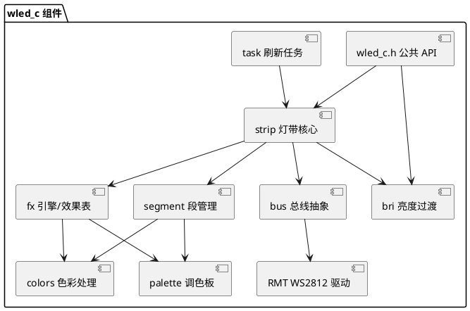

# 设计文档 — wled_c ESP-IDF 灯控组件

## 1. 技术架构

### 1.1 技术选型

- **交付形态**：单一 ESP-IDF 组件(`wlen_c/` 目录),通过 `idf_component_register()` 注册
- **目标框架**:ESP-IDF v5.x(仅依赖 IDF 自带组件:`driver`(RMT)、`esp_timer`、`freertos`、`log`)
- **语言**:C(GNU C17),面向对象风格采用"结构体 + 句柄 + 纯函数"模拟
- **输出驱动**:`driver/rmt_tx.h` 新版 RMT 驱动(Encoder 方式,WS2812 时序通过 `rmt_bytes_encoder` + 复制编码器实现)
- **并发模型**:FreeRTOS 独立任务(`wledc_task`)驱动固定帧率刷新循环,公共 API 通过互斥锁保证线程安全
- **帧率**:42 FPS(对应 WLED 的 `WLED_FPS`),帧周期约 23.8ms
- **禁止依赖**:Arduino、FastLED、NeoPixelBus、任何第三方组件

### 1.2 系统架构



**依赖规则**(自底向上,不允许反向依赖):
```
rmt_ws2812 ← bus ← strip ← fx/palette/colors/bri ← wled_c.h(统一入口)
```

### 1.3 核心数据流

```
API 调用(设置亮度/段/效果)
      │
      ▼
wledc_task(42FPS) ──► strip_service()
      │                    │
      │              对每个活跃段:
      │              fx_engine_run(mode)   ← 效果函数写段像素缓冲(段局部)
      │                    │
      │              段过渡混合(progress 插值)
      │                    │
      │              apply_brightness()  ← 全局亮度/过渡/乘数
      │                    │
      │              bus_manager_show()  ← 颜色顺序重排+缩放
      │                    │
      │              rmt_transmit()     ← RGBW→时序位流
      ▼
   LED 输出
```

## 2. 目录结构设计

```
wlen_c/
├── CMakeLists.txt            # idf_component_register(SRCS/INCLUDE_DIRS/REQUIRES)
├── Kconfig                   # 组件配置(默认帧率/任务栈/日志级别)
├── include/wled_c/           # 公共头文件(对外唯一入口)
│   ├── wled_c.h              # 组件主 API(start/stop/句柄)
│   ├── wled_c_types.h        # 公共类型/错误码/颜色宏
│   ├── wled_c_bus.h          # 总线配置与管理 API
│   ├── wled_c_segment.h      # 段结构与管理 API
│   ├── wled_c_fx.h           # 效果 ID 枚举与效果引擎 API
│   ├── wled_c_palette.h      # 调色板 API
│   └── wled_c_color.h        # 色彩工具函数 API
└── src/
    ├── wled_c_main.c         # 任务生命周期/start/stop/互斥锁
    ├── wled_c_strip.c        # 灯带核心与刷新循环
    ├── wled_c_segment.c      # 段实现(运行时数据/2D 映射/过渡)
    ├── wled_c_bus.c          # 总线抽象与 BusManager
    ├── wled_c_rmt.c          # RMT WS2812 驱动(encoder)
    ├── wled_c_fx.c           # 效果引擎调度(函数表)
    ├── wled_c_fx_1d.c        # 1D 效果实现
    ├── wled_c_fx_2d.c        # 2D 效果实现(可选,受 Kconfig 控制)
    ├── wled_c_fx_support.c   # 效果公共工具(oscillate/beatsin 等)
    ├── wled_c_palette.c      # 调色板表与插值取色
    ├── wled_c_color.c        # HSV/gamma/blend/scale 等
    └── wled_c_bri.c          # 亮度状态机与过渡
```

## 3. 详细设计

### 3.1 公共类型与宏(wled_c_types.h)

```c
// 32 位 RGBW 颜色打包(与 WLED 一致:0xWWRRGGBB)
#define RGBW32(r,g,b,w) ...
#define R(c) / G(c) / B(c) / W(c)

// 段选项位(与 FX.h 对齐)
#define SEG_OPT_SELECTED   0x0001
#define SEG_OPT_REVERSE    0x0002
#define SEG_OPT_ON         0x0004
#define SEG_OPT_MIRROR     0x0008
#define SEG_OPT_FREEZE     0x0010
#define SEG_OPT_RESET      0x0020
#define SEG_OPT_REVERSE_Y  0x0040
#define SEG_OPT_MIRROR_Y   0x0080
#define SEG_OPT_TRANSPOSE  0x0100

#define WLEDC_FPS          42
#define WLEDC_FRAME_TIME   (1000 / WLEDC_FPS)
#define WLEDC_MAX_SEGMENTS 32
#define WLEDC_NUM_COLORS   3
```

### 3.2 RMT WS2812 驱动(wled_c_rmt.c)

- 每总线一路 `rmt_tx_channel_config_t`(GPIO、分辨率 12.5MHz、`mem_block_symbols` 按像素数)
- `rmt_led_strip_encoder_new()`:组合 `bytes_encoder`(RGBW 4 字节,bit0=400ns/850ns,bit1=800ns/450ns,reset 300us)+ `copy_encoder`
- 接口:
```c
esp_err_t wledc_rmt_init(wledc_rmt_t *dev, const wledc_bus_config_t *cfg);
esp_err_t wledc_rmt_show(wledc_rmt_t *dev, const uint8_t *pixels, size_t len);
```
- `show` 前检查 `rmt_tx_wait_all_done()`(上一帧是否完成),未完成则跳过本帧(避免撕裂)

### 3.3 总线层(wled_c_bus.c)

```c
typedef struct {
  uint8_t  type;          // WLEDC_BUS_WS2812 / WLEDC_BUS_WS2812_RGBW
  gpio_num_t pin;
  uint16_t start;         // 起始像素
  uint16_t length;
  bool     reversed;
  uint8_t  color_order;   // COL_ORDER_GRB 等 12 种排列
  uint8_t  brightness;    // 总线级亮度
} wledc_bus_config_t;
```

- 内部隐藏 RMT/引脚细节,对 Strip 暴露统一接口:`set_pixel_color` / `set_brightness` / `show` / `get_pixel_color`
- 颜色顺序重排与亮度缩放作为纯逻辑在 `show()` 路径中批量完成
- 总线管理器支持最多 `WLEDC_MAX_BUSES`(4)总线并存,像素按 `start` 偏移路由

### 3.4 段层(wled_c_segment.c)

对齐 WLED `Segment` 字段,改为 C 结构体:

```c
typedef struct {
  uint32_t colors[WLEDC_NUM_COLORS];
  uint16_t start, stop, startY, stopY, offset;
  uint16_t options;            // SEG_OPT_* 位标志
  uint8_t  grouping, spacing;
  uint8_t  opacity, cct;
  uint8_t  mode, palette, speed, intensity, custom1, custom2, custom3;
  uint8_t  blend_mode;
  // 运行时
  uint32_t step, call;
  uint16_t aux0, aux1;
  uint8_t *data;               // 效果内部状态(lazy 分配)
  uint32_t *pixels;             // 段像素缓冲
} wledc_segment_t;
```

- 运行时数据 `data` 按 WLED `addUsedSegmentData` 模式管理:效果首次运行时请求、效果切换时统一重置
- 2D:`transpose`/`mirror_y`/`reverse_y` 坐标变换,`XY(x,y) = x + y * vWidth` 索引
- 过渡:`transition` 子结构持有旧段快照 + 进度(0-65535),支持颜色/调色板/亮度插值混合

### 3.5 效果引擎(wled_c_fx.c)

- 效果函数统一签名:
```c
typedef uint16_t (*wledc_fx_fn)(wledc_segment_t *seg);
```
- 效果表 `static const wledc_fx_fn wledc_fx_table[]`,ID 对应需求文档的 8 类 35+ 效果(静态/呼吸/追逐/闪烁/渐变/扫描/矩阵/动画)
- `wledc_fx_run(seg)`:`handle_random_palette()` → `reset_if_required()` → 调用 `fx_table[seg->mode](seg)` → 返回下次调用前的延迟微调(保持 42FPS 基准)
- `SEGMENT`/`SEGENV` 宏风格保留:引擎内部以 `_current_segment` 指针 + 内联宏访问当前段字段,降低效果函数改写成本

### 3.6 调色板(wled_c_palette.c)

- 16 停色点格式 `uint8_t[16*4]`(与 FastLED `TProgmemRGBPalette16` 布局兼容,直接拷贝 WLED `palettes.cpp` 数据,去除 PROGMEM 改为 `const`)
- `wledc_color_from_palette(pal, index, brightness, blend)`:线性插值取色
- 自定义调色板:`wledc_palette_register(const uint8_t *stops16)` 返回动态 ID(从 200 起)

### 3.7 色彩处理(wled_c_color.c)

全部重写为纯函数(自研实现,不从 FastLED 移植):
- `hsv2rgb_spectrum / hsv2rgb_rainbow`(16 位 hue)
- `rgb2hsv`
- `color_blend / color_add / color_fade / fast_color_scale`(位运算并行缩放)
- gamma 查找表(`calc_gamma_table`,可开关)
- `color_kto_rgb`、`color_balance_from_kelvin`

### 3.8 亮度模块(wled_c_bri.c)

移植 `led.cpp` 核心逻辑:
- `bri/bri_old/bri_t/bri_last` 四值状态机
- `transition_delay` 线性插值:`bri_t = bri_old + (bri - bri_old) * t / d`
- `toggle_on_off`(记忆 briLast)、`set_brightness`(触发过渡)、`bri_multiplier` 最终缩放
- 简化:去除夜灯 SUN 模式,保留 FADE/COLORFADE/SET

### 3.9 刷新任务与 API(wled_c_main.c)

```c
esp_err_t wled_c_start(const wled_c_config_t *cfg);  // 创建任务+初始化总线
esp_err_t wled_c_stop(void);
```

- 任务循环:`vTaskDelayUntil` 对齐 23.8ms → 加锁 → `handle_transitions()` + `strip_service()` → 解锁
- 所有公共 API 加互斥锁,保证与任务并发安全
- 日志统一 `ESP_LOGx`,TAG 为 `wled_c`

### 3.10 CMakeLists.txt

```cmake
idf_component_register(
  SRCS "src/*.c"
  INCLUDE_DIRS "include"
  REQUIRES driver esp_timer
)
```

Kconfig 提供:`CONFIG_WLEDC_FPS`、`CONFIG_WLEDC_TASK_STACK`、`CONFIG_WLEDC_ENABLE_2D`、`CONFIG_WLEDC_MAX_SEGMENTS`。

## 4. 质量保证

- **测试策略**:核心纯函数(色彩/调色板/插值)在主机端可测(不依赖外设的源文件隔离);总线/RMT 通过 ESP32 硬件实测;`example/` 提供最小验证工程
- **性能**:效果计算在 42FPS 预算内(单段 ≤1024 像素);RMT DMA 后台传输不阻塞 CPU
- **安全**:所有 API `esp_err_t` 返回;参数边界检查(段越界/总线满/像素超限);互斥锁超时保护
- **日志**:关键路径 `ESP_LOGD`,错误 `ESP_LOGE`